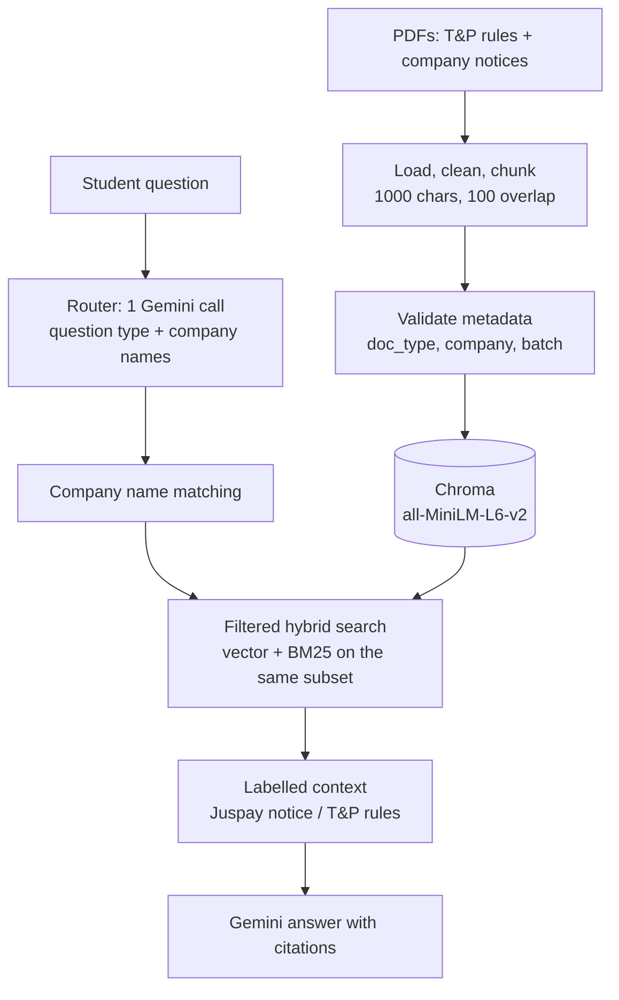

# Smart Placement RAG

A placement assistant for KIIT students. It answers questions about the university's Training & Placement (T&P) rules and about individual company recruitment notices, with page-level citations. It is built as a hybrid retrieval-augmented generation (RAG) pipeline: Chroma vector search plus BM25 keyword search, Gemini for answers, and a React frontend (PlaceMate AI).

Example questions it is built for:

- *"Can I reject an offer after being selected?"* (T&P rules)
- *"What is the CGPA cutoff for Osfin.ai?"* (one company's notice)
- *"I already have a 6 LPA offer. Can I sit for the Juspay drive?"* (a company notice and a T&P rule together)
- *"Compare the CTC of Mu Sigma and Tredence."* (several companies)

## Status

| Part | Status |
|---|---|
| Ingestion with a validated metadata schema (21 PDFs: T&P rules + 20 company notices) | Done |
| Hybrid retrieval with metadata filters (rules only, one company, all notices) | Done |
| Company name matching, with "Did you mean …?" for near misses | Done |
| Typed evaluation set (76 questions) and baseline-vs-router comparison | Done; live results pending |
| Query router (classifies a question and picks the searches) | Implemented; evaluation and extension planned for semester 8 |
| "Which companies …" questions over all notices (structured extraction table) | Planned, semester 8 |
| FastAPI backend connecting the frontend to the pipeline | Planned |
| React frontend (student, T&P admin, platform admin) | Done, runs on demo data |

## How it works



Two ideas carry the design:

1. **Every chunk carries metadata** (`doc_type`, `company`, `batch`, …), so a search can be restricted to "only the T&P rules" or "only Juspay's notice". Plain top-k search over everything lets other companies' chunks crowd out the one you need. In the first evaluation run, rules questions were already pulling in company notice chunks.
2. **The filter is applied to both halves of the hybrid search.** The BM25 index is built from exactly the chunks the vector search is allowed to see. If BM25 is built over everything, other companies' chunks leak back in through the keyword side.

## Repository layout

```
rag/
  loader.py          PDF loading, text cleanup (emoji / UTF-16 surrogates), chunking
  ingest.py          DocumentMetadata schema, ingest_document(): validate, chunk, upsert
  ingest_all.py      bulk ingestion of data/ using data/notices/registry.json
  vector_store.py    Chroma collection per college; upsert keyed on content hash
  embedder.py        sentence-transformers wrapper (all-MiniLM-L6-v2)
  retrieval.py       PlacementRetriever: search_rules / search_company / search_notices / search_all
  companies.py       CompanyNormalizer: exact names, aliases, fuzzy suggestions
  router.py          RouteDecision schema, router prompt, dispatch per question type
  answer.py          labelled context, answer generation, citations
  prompts.py         system prompt for the answer model
  pipeline.py        PlacementRAG.from_env().ask(question): the single entry point
  query.py, retriver.py   v1 baseline (kept for the original evaluation script)
data/
  rules/             T&P Regulations 2027 Batch PDF
  notices/           company notice PDFs + registry.json (file -> company, notice type, role, date, aliases)
evaluation/
  eval_set.py        76 typed questions with expected evidence snippets
  compare.py         baseline vs router report per question type, manual grading helper
  evaluate.py        v1 evaluation script and its saved results
tests/               offline tests (fake embeddings and LLM, real PDFs)
docs/ROUTER.md       retrieval and router design notes
frontend/            React + Vite frontend (see frontend/README.md)
main.py              command-line assistant
```

## Setup

Python 3.11+.

```bash
pip install -r requirements.txt
```

Create a `.env` file in the repository root:

```
GEMINI_API_KEY=your_key_here
# optional
ROUTER_MODEL=google_genai:gemini-3.5-flash-lite
ANSWER_MODEL=google_genai:gemini-3.5-flash-lite
BATCH=2027          # restrict every search to one graduating batch
```

The first run downloads the embedding model (about 90 MB).

## Ingest the documents

```bash
python -m rag.ingest_all --reset
```

`--reset` deletes `chroma_db/` and rebuilds it. Use it once after cloning and whenever the metadata schema or chunking changes. Without `--reset`, unchanged files are skipped and changed files are replaced. The run writes `ingest_report.json` and prints a chunk count per company, which should list all 20 companies plus the rules document.

**Adding a company notice:** put the PDF in `data/notices/`, add an entry to `data/notices/registry.json`, and run `python -m rag.ingest_all`:

```json
"Registration_for_Example_Recruitment_Drive.pdf": {
  "company": "Example Corp",
  "notice_type": "registration",
  "job_role": "SDE Intern",
  "notice_date": "2026-08-01"
}
```

`notice_type` is one of `registration`, `job_description`, `eligibility`, `ppt`, `schedule`, `update`, `general`. Nicknames that students might type go under `aliases` in the same file.

## Ask questions

```bash
python main.py "Can I reject an offer after being selected?"
python main.py --debug "I already have a 6 LPA offer. Can I sit for the Juspay drive?"
python main.py          # interactive mode; empty line to quit
```

`--debug` prints the chosen route, the resolved company names and every retrieved chunk.

From Python (this is what the backend should call):

```python
from rag.pipeline import PlacementRAG

rag = PlacementRAG.from_env()          # load once at startup
out = rag.ask("What is the CTC at Juspay?")
out["answer"], out["sources"], out["route"]["type"], out["suggested_question"]
```

### Question types

| Type | Example | What is searched |
|---|---|---|
| `rules` | Can I reject an offer? | T&P rules and placement FAQs |
| `company` | What is Juspay's CTC? | that company's notice |
| `company_rules` | I have a 6 LPA offer, can I sit for Juspay? | the company's notice + T&P rules |
| `multi_company` | Compare Mu Sigma and Tredence CTC | one search per company |
| `cross_company` | Which companies need 8 CGPA? | the closest notices across all companies (best effort; the full answer needs the semester 8 extraction table) |
| `out_of_scope` | Who won the IPL? | nothing; fixed reply |

### Company names

| Student types | Result |
|---|---|
| Exact name, any case or punctuation ("osfin ai") | used directly |
| A registered alias ("musigma", "xerox") | used directly |
| A close name ("Infosys Ltd", "springwork") | `Did you mean "Infosys" instead of "Infosys Ltd"?` plus `suggested_question`, which the frontend can show as a button |
| An unknown company ("Google") | "I don't have any recruitment notice for Google." |

If the router call fails twice, the question is answered from an unfiltered search instead of failing.

## Metadata contract

Every chunk in Chroma carries:

| Field | Meaning |
|---|---|
| `college_id` | college that owns the document (one Chroma collection per college) |
| `doc_type` | `tnp_rules`, `company_notice` or `placement_faq` |
| `batch` | graduating batch, e.g. `2027` |
| `document_id` | stable ID derived from the metadata, so re-uploading a notice replaces it |
| `document_name` | original filename or admin-provided title |
| `company` | normalised company identifier used for filtering (company notices only) |
| `company_display` | company name as shown to users (company notices only) |
| `notice_type` | registration, job_description, eligibility, … (company notices only) |
| `job_role` | only when provided |
| `notice_date` | `YYYYMMDD` as an integer, only when provided |
| `page` | zero-based PDF page; shown one-based in citations |
| `chunk_index`, `chunk_id` | position in the document and stable chunk ID |
| `content_hash` | SHA-256 of the PDF; unchanged files are skipped on re-ingest |
| `ingest_version` | chunking and embedding configuration version |
| `ingested_at` | Unix timestamp |

Chroma does not accept null values, so optional fields are omitted when they are not available.

## Evaluation

```bash
python -m evaluation.compare --no-answers      # routing + retrieval only, 1 LLM call per question
python -m evaluation.compare --sleep 4         # full run with answers (keep the sleep on the free tier)
python -m evaluation.compare --grade evaluation/compare_<timestamp>.json
```

The evaluation set (`evaluation/eval_set.py`) has 76 questions: 34 on T&P rules, 31 company-notice questions, 6 combining a company with a rule, 4 multi-company and 1 out of scope. Each has a gold question type, gold companies and short snippets that must appear in the retrieved text.

The report compares the baseline (the same hybrid search with no filters) against the router, per question type:

- **route ok:** the router picked the right question type
- **recall:** share of the needed evidence snippets that reached the answer model
- **purity:** share of retrieved notice chunks that belong to the right company
- **refusal ok:** questions the documents cannot answer were declined

Answer correctness is graded by hand: fill `correct` and `hallucinated` in the saved JSON, then run `--grade`.

## Tests

```bash
python -m pytest -q tests
```

34 tests run offline with fake embeddings and fake LLMs on the real PDFs. They cover ingestion (all files, idempotent re-ingest, clean text), filtered retrieval for every company, company name matching, every router path including fallbacks, the batch filter and the evaluation harness.

## Frontend

```bash
cd frontend
npm install
npm run dev        # http://localhost:5173
```

It runs on built-in demo data by default (`VITE_USE_MOCK=true`). See `frontend/README.md` for the roles, the demo flow and the API shape it expects from the backend.

## Known limitations

- "Which companies …" questions search the closest notices only, so lists can be incomplete. The answer says so.
- Scanned PDFs without a text layer are rejected at ingestion; they need OCR.
- all-MiniLM-L6-v2 reads at most 256 tokens per chunk (about 1,000 characters of English), so the end of a long chunk is not embedded.
- On the Gemini free tier, latency and rate limits vary; the evaluation script has a `--sleep` option for this.

## Roadmap (semester 8)

1. Evaluate the router on the live system and tune it per question type.
2. Structured extraction at ingestion (CGPA cutoff, CTC, branches, deadline, rounds → SQL table) to answer "which companies …" questions exactly.
3. LangSmith tracing for every step.
4. LangGraph flow with one bounded retry when retrieval looks weak.
5. Reranking and contextual retrieval, kept only if the evaluation improves.
6. FastAPI backend with authentication, per-college isolation and caching, connected to the frontend.
